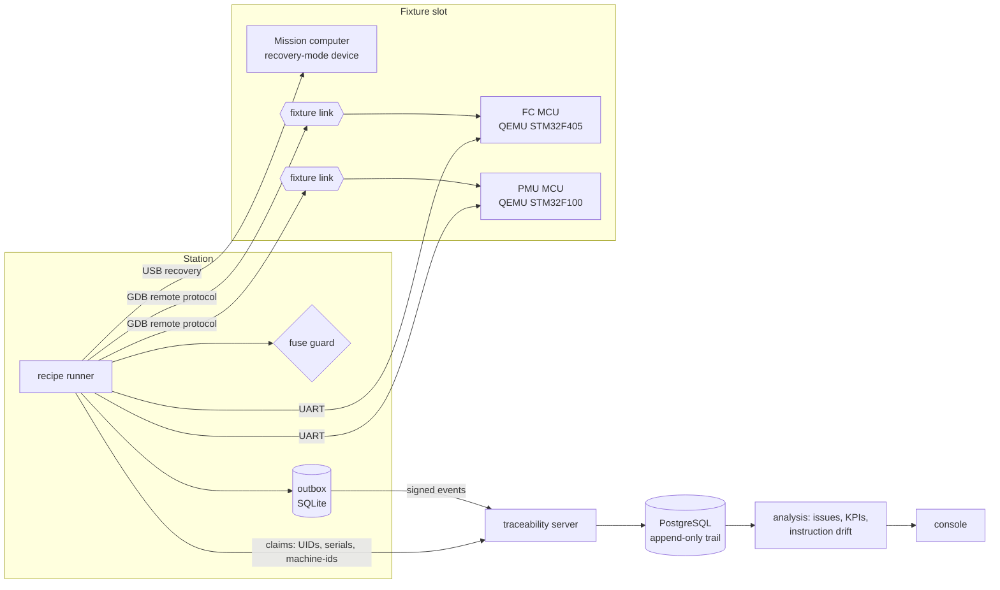

# Design

## A step

Every step of `config/recipes/standard.yaml` goes the same way in `station/runner.py`:

1. an `intent` event is appended to the unit's chain and committed to the outbox
2. the step runs against its target and returns its evidence (hashes, banner, versions, identities)
3. a `result` event records ok or the failure code, the evidence and the time it took
4. on a failure, `config/codes.yaml` decides: another attempt (after a recovery the operator does, restarting at
   the step the code names) or a hold for the code's owner

The irreversible step adds one more: `station/guards.py` lists every unmet precondition, the list goes into the
trail, and the burn happens only on an empty list.

## Identities

Each board's supplier identity (UID, revision, lot) comes from its OTP; the module's from its EEPROM; the kit
(lots and batch) from MES at the scan. The server holds first-come claims on FC and PMU UIDs, module serials and
machine-ids, so a board moved between airframes or a duplicated machine-id is caught at the step that reads it.

## The trail

Events carry the previous event's hash and the station's signature over their own hash. The server accepts an
event only as the next one of its unit's chain. It stores the event verbatim for re-verification and refuses
updates and deletes with a trigger. Units, attempts and recoveries are derived from the trail in the same
transaction.

## The analysis

For a failure code, the trials are all attempts at the steps where the code occurs. For every place (a value of
a slot, fixture, station, operator, release, board revision, lot, SKU, FAB or batch), Fisher's exact test asks
how surprising its share of the failures is, given its share of the attempts. The level is alpha divided by the
number of places tested for that code. The strongest place is kept, or a narrower place if it explains at least
80% of the same failures. Its failures are then set aside and the search repeats, up to three places per code.
Failures nothing explains are one-off, or widespread when the code fails often everywhere. Module link speed is
analysed as its own signal. Thresholds live in `config/analysis.yaml`.

## Why the emulated line is believable

- the flasher speaks the GDB protocol to a real CPU emulator running real firmware, so read-back, resets,
  stale stop replies and Nagle's algorithm (40 ms per packet until TCP_NODELAY) are real problems, solved for real
- firmware idles with WFI, so a dozen emulated parts do not saturate the host
- faults are injected between the station and the part, not inside the station
